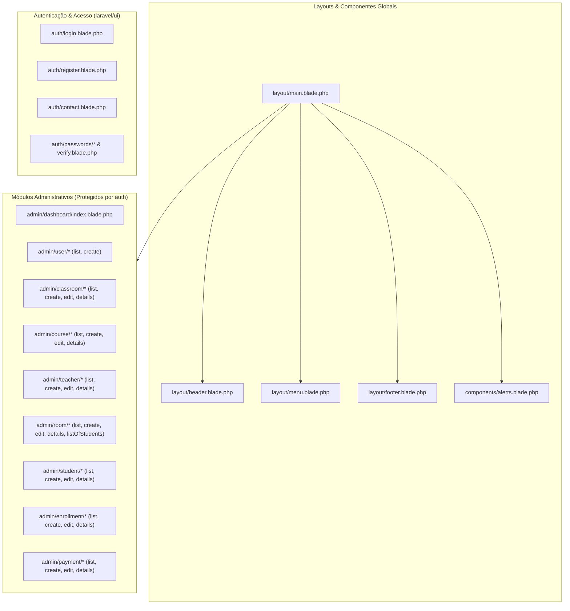

# Documentação das Views — Sistema de Gestão do Centro de Formação

Este documento descreve a organização, finalidade, rotas e responsabilidades de cada uma das *views* (`resources/views/`) do **Sistema Integrado de Gestão Académica e Financeira**.

---

## 1. Arquitetura Visual (Diagrama Geral)

---

## 2. Layouts Base e Componentes (`resources/views/layout/` e `components/`)

| Ficheiro | Função Principal |
| :--- | :--- |
| [main.blade.php](file:///home/eneto/Documents/infosi%20intership/projects/centroFormacao/resources/views/layout/main.blade.php) | **Layout Mestre** de todas as páginas internas do sistema. Carrega as folhas de estilo (`style.css`, `custom-tables.css`, DataTables), inicializa o tema claro/escuro sem *flash* visual, inclui o cabeçalho, o menu lateral, a área dinâmica `@yield('content')`, o rodapé e os scripts globais (`Chart.js`, `DataTables`, `theme-init.js`). |
| [header.blade.php](file:///home/eneto/Documents/infosi%20intership/projects/centroFormacao/resources/views/layout/header.blade.php) | **Barra Superior Institucional**. Apresenta o logótipo do Centro de Formação, controlo de recolha do menu lateral (*hamburger*), título dinâmico da secção (`@yield('title')`), alternador de **Modo Claro / Escuro**, botão de ecrã inteiro, identificação do utilizador autenticado e botão de terminar sessão (`POST /logout`). |
| [menu.blade.php](file:///home/eneto/Documents/infosi%20intership/projects/centroFormacao/resources/views/layout/menu.blade.php) | **Menu Lateral de Navegação (Sidebar)**. Organiza os módulos por áreas funcionais (*Visão Geral*, *Administração*, *Infraestrutura & Ensino*, *Gestão Pedagógica*, *Secretaria & Finanças*), destacando automaticamente a rota ativa (`mm-active`) e exibindo o estado operacional no rodapé lateral. |
| [footer.blade.php](file:///home/eneto/Documents/infosi%20intership/projects/centroFormacao/resources/views/layout/footer.blade.php) | **Rodapé Institucional Centralizado**. Exibe o nome oficial do sistema e os créditos de desenvolvimento (**INFOSI**) com suporte para Modo Claro e Escuro. |
| [alerts.blade.php](file:///home/eneto/Documents/infosi%20intership/projects/centroFormacao/resources/views/components/alerts.blade.php) | **Componente de Alertas (`<x-alerts />`)**. Renderiza mensagens de sessão (`success`, `danger`, `warning`, `info`) com ícones contextuais e botão de fecho. |

---

## 3. Autenticação e Acesso Público (`resources/views/auth/`)

| Ficheiro | Rota / Controlador | Descrição |
| :--- | :--- | :--- |
| [login.blade.php](file:///home/eneto/Documents/infosi%20intership/projects/centroFormacao/resources/views/auth/login.blade.php) | `GET /login` (`LoginController@showLoginForm`) | Ecrã de início de sessão com identidade visual própria (`auth.css`), validação de e-mail e palavra-passe, caixa *Manter sessão iniciada* e atalho para contactar a administração. |
| [register.blade.php](file:///home/eneto/Documents/infosi%20intership/projects/centroFormacao/resources/views/auth/register.blade.php) | `GET /register` (`RegisterController@showRegistrationForm`) | Formulário de criação de conta (nome completo, e-mail, palavra-passe e confirmação) integrado com `laravel/ui`. |
| [contact.blade.php](file:///home/eneto/Documents/infosi%20intership/projects/centroFormacao/resources/views/auth/contact.blade.php) | `GET /contact` (`LoginController@showContactForm`) | Página pública para utilizadores sem conta submeterem o seu e-mail (`POST /lead`) para contacto futuro pela administração. |
| [verify.blade.php](file:///home/eneto/Documents/infosi%20intership/projects/centroFormacao/resources/views/auth/verify.blade.php) | `GET /email/verify` (`VerificationController`) | Ecrã de verificação de endereço de e-mail gerado pelo `laravel/ui`. |
| [email.blade.php](file:///home/eneto/Documents/infosi%20intership/projects/centroFormacao/resources/views/auth/passwords/email.blade.php) | `GET /password/reset` (`ForgotPasswordController`) | Formulário para solicitar link de recuperação de palavra-passe por e-mail. |
| [reset.blade.php](file:///home/eneto/Documents/infosi%20intership/projects/centroFormacao/resources/views/auth/passwords/reset.blade.php) | `GET /password/reset/{token}` (`ResetPasswordController`) | Formulário para definir uma nova palavra-passe através do token de recuperação. |
| [confirm.blade.php](file:///home/eneto/Documents/infosi%20intership/projects/centroFormacao/resources/views/auth/passwords/confirm.blade.php) | `GET /password/confirm` (`ConfirmPasswordController`) | Ecrã de confirmação de palavra-passe antes de ações sensíveis. |

---

## 4. Painel de Controlo (`resources/views/admin/dashboard/`)

| Ficheiro | Rota / Controlador | Descrição |
| :--- | :--- | :--- |
| [index.blade.php](file:///home/eneto/Documents/infosi%20intership/projects/centroFormacao/resources/views/admin/dashboard/index.blade.php) | `GET /` (`DashboardController@index`) | **Dashboard Analítico e Executivo**. Estruturado em 4 linhas responsivas: 1. **4 KPIs Executivos**: Receita Liquidada (Kz), Formandos Ativos (% lotação), Total de Inscrições (% conversão) e Turmas em Funcionamento. 2. **4 Mini-Indicadores**: Salas físicas, Oferta Formativa, Corpo Docente e Funil de Admissão. 3. **Gráficos Analíticos (`dashboard-init.js`)**: Gráfico de barras comparativo dos últimos 6 meses (Inscrições vs. Matrículas + Receita), barras de progresso dos Top 5 Cursos mais procurados e gráfico *Doughnut* de distribuição de turmas por turno. 4. **Tabelas Operacionais Compactas**: Últimas 5 Inscrições (*Candidato, Curso, Estado*) e Últimos 5 Pagamentos (*Recibo, Candidato, Valor*). |

---

## 5. Módulo de Utilizadores (`resources/views/admin/user/`)

| Ficheiro | Rota / Controlador | Descrição |
| :--- | :--- | :--- |
| [list/index.blade.php](file:///home/eneto/Documents/infosi%20intership/projects/centroFormacao/resources/views/admin/user/list/index.blade.php) | `GET /utilizador/listar` (`RegisterController@index`) | Lista todas as contas administrativas do sistema, sinaliza a conta com *Sessão Atual* e permite remover outros utilizadores com confirmação. |
| [create/index.blade.php](file:///home/eneto/Documents/infosi%20intership/projects/centroFormacao/resources/views/admin/user/create/index.blade.php) | `GET /utilizador/adicionar` (`RegisterController@createForm`) | Formulário interno para o administrador registar novos utilizadores sem terminar a sua sessão atual. |

---

## 6. Módulo de Salas de Aula (`resources/views/admin/classroom/`)

| Ficheiro | Rota / Controlador | Descrição |
| :--- | :--- | :--- |
| [list/index.blade.php](file:///home/eneto/Documents/infosi%20intership/projects/centroFormacao/resources/views/admin/classroom/list/index.blade.php) | `GET /sala/listar` (`ClassroomController@index`) | Tabela essencial com **Sala**, **Capacidade**, **Turmas Alocadas** e menu de **Acções**. |
| [create/index.blade.php](file:///home/eneto/Documents/infosi%20intership/projects/centroFormacao/resources/views/admin/classroom/create/index.blade.php) | `GET /sala/adicionar` (`ClassroomController@create`) | Formulário para registar uma nova sala física (número da sala, lotação máxima e observações/equipamentos). |
| [edit/index.blade.php](file:///home/eneto/Documents/infosi%20intership/projects/centroFormacao/resources/views/admin/classroom/edit/index.blade.php) | `GET /sala/edit/{id}` (`ClassroomController@edit`) | Formulário para atualizar o número, capacidade ou descrição de uma sala existente. |
| [details/index.blade.php](file:///home/eneto/Documents/infosi%20intership/projects/centroFormacao/resources/views/admin/classroom/details/index.blade.php) | `GET /sala/{id}` (`ClassroomController@show`) | Ficha detalhada da sala física, mostrando a capacidade instalada, observações e a lista de todas as turmas que funcionam nesse espaço. |

---

## 7. Módulo de Cursos (`resources/views/admin/course/`)

| Ficheiro | Rota / Controlador | Descrição |
| :--- | :--- | :--- |
| [list/index.blade.php](file:///home/eneto/Documents/infosi%20intership/projects/centroFormacao/resources/views/admin/course/list/index.blade.php) | `GET /curso/listar` (`CourseController@index`) | Tabela com **Curso**, **Preço (Kz)**, **Turmas**, **Estado** (*Ativo/Inativo*) e **Acções**. |
| [create/index.blade.php](file:///home/eneto/Documents/infosi%20intership/projects/centroFormacao/resources/views/admin/course/create/index.blade.php) | `GET /curso/adicionar` (`CourseController@create`) | Formulário de criação de curso (nome, duração em horas, valor da propina em Kwanzas, estado e conteúdo programático). |
| [edit/index.blade.php](file:///home/eneto/Documents/infosi%20intership/projects/centroFormacao/resources/views/admin/course/edit/index.blade.php) | `GET /curso/edit/{id}` (`CourseController@edit`) | Formulário de atualização dos dados pedagógicos e financeiros de um curso. |
| [details/index.blade.php](file:///home/eneto/Documents/infosi%20intership/projects/centroFormacao/resources/views/admin/course/details/index.blade.php) | `GET /curso/{id}` (`CourseController@show`) | Vista detalhada do curso, apresentando carga horária, preço, descrição completa, estatísticas e turmas associadas. |

---

## 8. Módulo de Formadores (`resources/views/admin/teacher/`)

| Ficheiro | Rota / Controlador | Descrição |
| :--- | :--- | :--- |
| [list/index.blade.php](file:///home/eneto/Documents/infosi%20intership/projects/centroFormacao/resources/views/admin/teacher/list/index.blade.php) | `GET /formador/listar` (`TeacherController@index`) | Tabela enxuta do corpo docente com **Formador**, **Especialização**, **Turmas** atribuídas e **Acções**. |
| [create/index.blade.php](file:///home/eneto/Documents/infosi%20intership/projects/centroFormacao/resources/views/admin/teacher/create/index.blade.php) | `GET /formador/adicionar` (`TeacherController@create`) | Formulário para registar um formador (nome, BI, data de nascimento, género, telefone, e-mail, especialização, fotografia e biografia). |
| [edit/index.blade.php](file:///home/eneto/Documents/infosi%20intership/projects/centroFormacao/resources/views/admin/teacher/edit/index.blade.php) | `GET /formador/edit/{id}` (`TeacherController@edit`) | Formulário para editar os dados pessoais, contactos, especialização e fotografia do formador. |
| [details/index.blade.php](file:///home/eneto/Documents/infosi%20intership/projects/centroFormacao/resources/views/admin/teacher/details/index.blade.php) | `GET /formador/{id}` (`TeacherController@show`) | Perfil completo do formador com fotografia, contactos, documento de identificação e lista de turmas lecionadas. |

---

## 9. Módulo de Turmas (`resources/views/admin/room/`)

| Ficheiro | Rota / Controlador | Descrição |
| :--- | :--- | :--- |
| [list/index.blade.php](file:///home/eneto/Documents/infosi%20intership/projects/centroFormacao/resources/views/admin/room/list/index.blade.php) | `GET /turma/listar` (`RoomController@index`) | Tabela com **Turma**, **Curso**, **Formador**, **Vagas** (`ocupadas/capacidade`), **Estado** (*Aberta, Em curso, Concluída, Cancelada*) e **Acções**. |
| [create/index.blade.php](file:///home/eneto/Documents/infosi%20intership/projects/centroFormacao/resources/views/admin/room/create/index.blade.php) | `GET /turma/adicionar` (`RoomController@create`) | Formulário de abertura de turma com seleção de curso, formador, sala física, turno, horários de início/fim, datas e lotação máxima. |
| [edit/index.blade.php](file:///home/eneto/Documents/infosi%20intership/projects/centroFormacao/resources/views/admin/room/edit/index.blade.php) | `GET /turma/edit/{id}` (`RoomController@edit`) | Formulário de edição de horário, sala, formador, estado e capacidade da turma. |
| [details/index.blade.php](file:///home/eneto/Documents/infosi%20intership/projects/centroFormacao/resources/views/admin/room/details/index.blade.php) | `GET /turma/{id}` (`RoomController@show`) | Painel completo da turma: barra de progresso de ocupação, dados do curso, formador e sala, listagem nominal de formandos matriculados, candidaturas associadas e botão para imprimir pauta. |
| [details/listOfStudents.blade.php](file:///home/eneto/Documents/infosi%20intership/projects/centroFormacao/resources/views/admin/room/details/listOfStudents.blade.php) | `GET /turma/{id}/imprimir-formandos` (`RoomController@printStudents`) | **Vista de Impressão Oficial (Pauta Nominal)**. Documento formatado para impressão A4 com cabeçalho institucional, dados da turma e grelha de presença/assinatura dos formandos matriculados. |

---

## 10. Módulo de Formandos (`resources/views/admin/student/`)

| Ficheiro | Rota / Controlador | Descrição |
| :--- | :--- | :--- |
| [list/index.blade.php](file:///home/eneto/Documents/infosi%20intership/projects/centroFormacao/resources/views/admin/student/list/index.blade.php) | `GET /formando/listar` (`StudentController@index`) | Tabela com **Código** (`EST-...`), **Formando**, **Curso**, **Turma** e **Acções** (ver ficha, editar, imprimir pauta, eliminar). |
| [create/index.blade.php](file:///home/eneto/Documents/infosi%20intership/projects/centroFormacao/resources/views/admin/student/create/index.blade.php) | `GET /formando/adicionar` (`StudentController@create`) | Formulário de matrícula manual de formando ou conversão a partir de uma inscrição paga. |
| [edit/index.blade.php](file:///home/eneto/Documents/infosi%20intership/projects/centroFormacao/resources/views/admin/student/edit/index.blade.php) | `GET /formando/edit/{id}` (`StudentController@edit`) | Formulário para atualizar dados pessoais do formando ou transferi-lo de turma. |
| [details/index.blade.php](file:///home/eneto/Documents/infosi%20intership/projects/centroFormacao/resources/views/admin/student/details/index.blade.php) | `GET /formando/{id}` (`StudentController@show`) | Ficha académica individual completa do formando: fotografia, código de estudante, BI, contactos, turma atribuída, horário, sala e ligação à inscrição/pagamento de origem. |

---

## 11. Módulo de Inscrições / Candidaturas (`resources/views/admin/enrollment/`)

| Ficheiro | Rota / Controlador | Descrição |
| :--- | :--- | :--- |
| [list/index.blade.php](file:///home/eneto/Documents/infosi%20intership/projects/centroFormacao/resources/views/admin/enrollment/list/index.blade.php) | `GET /inscricao/listar` (`EnrollmentController@index`) | Tabela essencial com **Código** (`INS-...`), **Candidato**, **Curso**, **Estado** (*Pendente, Pago, Matriculado, Lista de Espera, Cancelado*) e **Acções** contextuais. |
| [create/index.blade.php](file:///home/eneto/Documents/infosi%20intership/projects/centroFormacao/resources/views/admin/enrollment/create/index.blade.php) | `GET /inscricao/adicionar` (`EnrollmentController@create`) | Formulário de pré-inscrição/candidatura com filtragem dinâmica de turmas por curso e turno (`enrollment-form.js`). |
| [edit/index.blade.php](file:///home/eneto/Documents/infosi%20intership/projects/centroFormacao/resources/views/admin/enrollment/edit/index.blade.php) | `GET /inscricao/edit/{id}` (`EnrollmentController@edit`) | Formulário para edição dos dados do candidato, curso pretendido, turno, turma e estado da inscrição. |
| [details/index.blade.php](file:///home/eneto/Documents/infosi%20intership/projects/centroFormacao/resources/views/admin/enrollment/details/index.blade.php) | `GET /inscricao/{id}` (`EnrollmentController@show`) | Dossiê completo da candidatura: exibe dados pessoais, curso/turma pretendida, histórico de pagamentos associados e botões de fluxo rápido (**Registar Pagamento** se *Pendente*, ou **Efetivar Matrícula em Formando** se *Pago*). |

---

## 12. Módulo de Pagamentos (`resources/views/admin/payment/`)

| Ficheiro | Rota / Controlador | Descrição |
| :--- | :--- | :--- |
| [list/index.blade.php](file:///home/eneto/Documents/infosi%20intership/projects/centroFormacao/resources/views/admin/payment/list/index.blade.php) | `GET /pagamento/listar` (`PaymentController@index`) | Painel financeiro com 3 cartões de resumo (Receita Confirmada, Pagamentos Pendentes e Total de Transações) e tabela com **Recibo** (`REC-...`), **Candidato**, **Valor**, **Estado** e **Ações**. |
| [create/index.blade.php](file:///home/eneto/Documents/infosi%20intership/projects/centroFormacao/resources/views/admin/payment/create/index.blade.php) | `GET /pagamento/adicionar` (`PaymentController@create`) | Formulário de liquidação de propina/inscrição com preenchimento automático do valor do curso e pré-visualização dos dados do candidato (`payment-form.js`). |
| [edit/index.blade.php](file:///home/eneto/Documents/infosi%20intership/projects/centroFormacao/resources/views/admin/payment/edit/index.blade.php) | `GET /pagamento/edit/{id}` (`PaymentController@edit`) | Formulário para confirmação de pagamento pendente ou anulação justificada de recibo. |
| [details/index.blade.php](file:///home/eneto/Documents/infosi%20intership/projects/centroFormacao/resources/views/admin/payment/details/index.blade.php) | `GET /pagamento/{id}` (`PaymentController@show`) | **Comprovativo / Recibo Oficial de Pagamento**. Apresenta a referência do recibo, candidato, curso, método de pagamento, data, estado e valor em Kwanzas, com suporte para impressão. |
