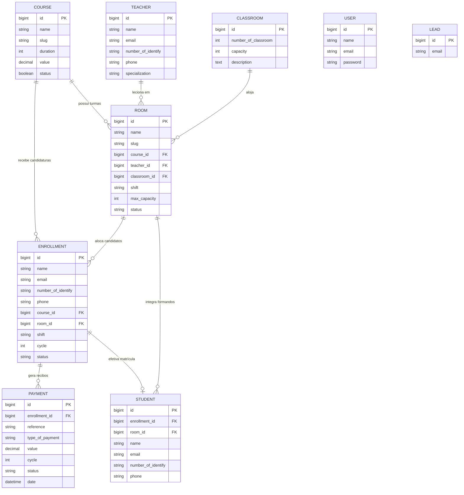
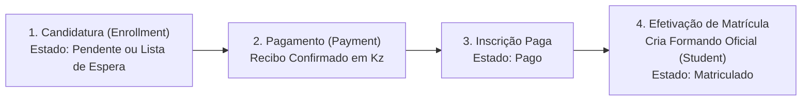

# Estrutura e Arquitetura do Projeto — Centro de Formação

Documentação técnica completa da estrutura de diretórios, arquitetura MVC, modelos de dados, controladores, validações, vistas e fluxos de negócio do **Sistema Integrado de Gestão Académica e Financeira (Centro de Formação)** desenvolvido em **Laravel 7** com **MySQL** e **`laravel/ui:^2.4`**.

---

## 1. Árvore Completa de Diretórios do Projeto

```text
centroFormacao/
├── app/
│   ├── Console/
│   │   └── Kernel.php                              # Registo de comandos Artisan e agendamento
│   ├── Exceptions/
│   │   └── Handler.php                             # Tratamento global de exceções HTTP
│   ├── Http/
│   │   ├── Controllers/
│   │   │   ├── Auth/                               # Controladores de Autenticação (laravel/ui:^2.4)
│   │   │   │   ├── LoginController.php             # Login, Logout, Contacto e submissão de Leads
│   │   │   │   ├── RegisterController.php          # Registo e Gestão Interna de Utilizadores (Admin)
│   │   │   │   ├── ForgotPasswordController.php    # Pedido de recuperação de palavra-passe
│   │   │   │   ├── ResetPasswordController.php     # Redefinição de palavra-passe
│   │   │   │   ├── ConfirmPasswordController.php   # Confirmação de palavra-passe
│   │   │   │   └── VerificationController.php      # Verificação de e-mail
│   │   │   ├── Controller.php                      # Controlador base do Laravel
│   │   │   ├── DashboardController.php             # Painel de Controlo, KPIs e dados analíticos
│   │   │   ├── ClassroomController.php             # CRUD de Salas de Aula Físicas
│   │   │   ├── CourseController.php                # CRUD de Cursos Formativos
│   │   │   ├── TeacherController.php               # CRUD de Formadores (Corpo Docente)
│   │   │   ├── RoomController.php                  # CRUD de Turmas e Impressão de Pautas
│   │   │   ├── EnrollmentController.php            # CRUD de Inscrições / Candidaturas e Lista de Espera
│   │   │   ├── PaymentController.php               # CRUD de Pagamentos, Recibos e Anulações
│   │   │   └── StudentController.php               # CRUD de Formandos e Efetivação de Matrícula
│   │   ├── Middleware/                             # Middlewares de autenticação, CSRF e sessão
│   │   ├── Requests/                               # Validação desacoplada (Form Requests)
│   │   │   ├── ClassroomRequest.php                # Regras de validação de Salas de Aula
│   │   │   ├── CourseRequest.php                   # Regras de validação de Cursos
│   │   │   ├── TeacherRequest.php                  # Regras de validação de Formadores
│   │   │   ├── RoomRequest.php                     # Regras de validação de Turmas e conflitos
│   │   │   ├── EnrollmentRequest.php               # Regras de validação de Inscrições
│   │   │   ├── PaymentRequest.php                  # Regras de validação de Pagamentos
│   │   │   └── StudentRequest.php                  # Regras de validação de Formandos
│   │   └── Kernel.php                              # Registo de middlewares HTTP globais e de rota
│   ├── Models/                                     # Modelos Eloquent (ORM)
│   │   ├── User.php                                # Utilizadores administrativos do sistema
│   │   ├── Lead.php                                # Contactos / Leads submetidos na página pública
│   │   ├── Classroom.php                           # Salas de aula físicas
│   │   ├── Course.php                              # Cursos da oferta formativa
│   │   ├── Teacher.php                             # Formadores
│   │   ├── Room.php                                # Turmas pedagógicas
│   │   ├── Enrollment.php                          # Candidaturas / Pré-inscrições
│   │   ├── Payment.php                             # Pagamentos e recibos em Kwanzas (AOA)
│   │   └── Student.php                             # Formandos oficialmente matriculados
│   ├── Providers/
│   │   ├── AppServiceProvider.php
│   │   ├── AuthServiceProvider.php
│   │   ├── BroadcastServiceProvider.php
│   │   ├── EventServiceProvider.php
│   │   └── RouteServiceProvider.php                # Define HOME = '/' e mapeia rotas web/api
│   └── View/
│       └── Components/
│           └── Alerts.php                          # Componente Blade <x-alerts />
├── config/
│   ├── app.php                                     # Configuração global da aplicação
│   ├── auth.php                                    # Guards e Provider apontando para App\Models\User
│   └── database.php                                # Configuração da ligação MySQL (centroformacao)
├── database/
│   ├── factories/
│   │   └── UserFactory.php
│   ├── migrations/                                 # Histórico estrutural da Base de Dados MySQL
│   │   ├── 2014_10_12_000000_create_users_table.php
│   │   ├── 2014_10_12_100000_create_password_resets_table.php
│   │   ├── 2019_08_19_000000_create_failed_jobs_table.php
│   │   ├── 2026_09_23_100000_create_classrooms_table.php
│   │   ├── 2026_09_23_100100_create_courses_table.php
│   │   ├── 2026_09_23_100200_create_teachers_table.php
│   │   ├── 2026_09_23_100300_create_rooms_table.php
│   │   ├── 2026_09_23_100400_create_enrollments_table.php
│   │   ├── 2026_09_23_100500_create_payments_table.php
│   │   ├── 2026_09_23_100600_create_students_table.php
│   │   ├── 2026_10_14_100000_add_payment_cycles_and_cancellation.php
│   │   ├── 2026_10_17_115613_add_slug_to_courses_table.php
│   │   ├── 2026_10_17_115625_add_slug_to_rooms_table.php
│   │   └── 2026_10_21_000001_create_leads_table.php
│   └── seeds/
│       └── DatabaseSeeder.php                      # Seeder completo de demonstração (Angola / AOA)
├── public/
│   ├── css/
│   │   ├── style.css                               # Folha de estilos base do tema
│   │   ├── auth.css                                # Estilos exclusivos das páginas de Login/Registo/Contacto
│   │   ├── custom-tables.css                       # Design System Institucional (#1E40AF), Dashboard, Tabelas, Footer e Dark Mode
│   │   ├── payment-form.css                        # Estilos dos formulários e recibos financeiros
│   │   └── teacher-form.css                        # Estilos dos formulários de formadores
│   └── js/
│       ├── theme-init.js                           # Gestão de Modo Claro/Escuro e posicionamento de dropdowns
│       ├── dashboard-init.js                       # Gráficos Chart.js responsivos do Dashboard
│       ├── enrollment-form.js                      # Filtragem dinâmica de turmas na inscrição
│       └── payment-form.js                         # Cálculo e pré-visualização automática no pagamento
├── resources/
│   ├── lang/en/auth.php                            # Mensagens de autenticação traduzidas para português
│   └── views/
│       ├── layout/                                 # main.blade.php, header.blade.php, menu.blade.php, footer.blade.php
│       ├── components/                             # alerts.blade.php
│       ├── auth/                                   # login.blade.php, register.blade.php, contact.blade.php, passwords/*
│       └── admin/                                  # Vistas de gestão por módulo
│           ├── dashboard/                          # index.blade.php
│           ├── user/                               # list/index.blade.php, create/index.blade.php
│           ├── classroom/                          # list, create, edit, details
│           ├── course/                             # list, create, edit, details
│           ├── teacher/                            # list, create, edit, details
│           ├── room/                               # list, create, edit, details (+ listOfStudents.blade.php)
│           ├── student/                            # list, create, edit, details
│           ├── enrollment/                         # list, create, edit, details
│           └── payment/                            # list, create, edit, details
├── routes/
│   ├── web.php                                     # Rotas web (Auth::routes() + rotas protegidas)
│   ├── api.php                                     # Rotas de API
│   └── console.php                                 # Comandos de consola
├── DOCUMENTACAO_VIEWS.md                           # Catálogo detalhado de todas as views do projeto
├── ESTRUTURA_PROJETO.md                            # Este documento de arquitetura e estrutura
└── composer.json                                   # Dependências PHP (laravel/framework ^7.0, laravel/ui ^2.4)
```

---

## 2. Diagrama Entidade-Relacionamento (Base de Dados MySQL)



---

## 3. Fluxo Pedagógico e Financeiro do Sistema



1. **Inscrição / Candidatura ([`EnrollmentController`](file:///home/eneto/Documents/infosi%20intership/projects/centroFormacao/app/Http/Controllers/EnrollmentController.php))**:
   - O candidato escolhe o curso e turno.
   - Se houver turma aberta com vagas, fica alocado no estado **`Pendente`** (aguardando pagamento).
   - Se não houver turma disponível ou a turma estiver lotada, entra automaticamente em **`Lista de Espera`** (sendo alocado automaticamente assim que uma nova turma compatível é aberta em [`RoomController@store`](file:///home/eneto/Documents/infosi%20intership/projects/centroFormacao/app/Http/Controllers/RoomController.php)).
2. **Liquidação de Propina ([`PaymentController`](file:///home/eneto/Documents/infosi%20intership/projects/centroFormacao/app/Http/Controllers/PaymentController.php))**:
   - Quando o pagamento é registado como **`Confirmado`**, a inscrição transita automaticamente para o estado **`Pago`** e é emitido o recibo oficial (`REC-AAAA-XXXXX`).
3. **Matrícula Oficial ([`StudentController`](file:///home/eneto/Documents/infosi%20intership/projects/centroFormacao/app/Http/Controllers/StudentController.php))**:
   - A partir de uma inscrição com estado **`Pago`**, a secretaria efetiva a matrícula (`POST /inscricao/{id}/efectivar`), gerando o registo oficial de formando (`EST-AAAA-XXXXX`) na turma e atualizando a inscrição para **`Matriculado`**.

---

## 4. Camadas da Aplicação

### 4.1. Controladores (`app/Http/Controllers/`)
- **[`Auth/LoginController.php`](file:///home/eneto/Documents/infosi%20intership/projects/centroFormacao/app/Http/Controllers/Auth/LoginController.php)**: Autenticação via `AuthenticatesUsers` (`laravel/ui:^2.4`), *throttling* de tentativas, *logout* seguro e receção de *leads* na página de contacto.
- **[`Auth/RegisterController.php`](file:///home/eneto/Documents/infosi%20intership/projects/centroFormacao/app/Http/Controllers/Auth/RegisterController.php)**: Registo de contas via `RegistersUsers` e gestão administrativa interna de utilizadores (`/utilizador/*`).
- **[`DashboardController.php`](file:///home/eneto/Documents/infosi%20intership/projects/centroFormacao/app/Http/Controllers/DashboardController.php)**: Consolida KPIs financeiros e académicos, séries temporais dos últimos 6 meses, distribuição por turnos e as 5 últimas inscrições/pagamentos.
- **[`ClassroomController.php`](file:///home/eneto/Documents/infosi%20intership/projects/centroFormacao/app/Http/Controllers/ClassroomController.php)**: Gestão de salas físicas, impedindo a remoção de salas com turmas ativas.
- **[`CourseController.php`](file:///home/eneto/Documents/infosi%20intership/projects/centroFormacao/app/Http/Controllers/CourseController.php)**: Gestão do catálogo de cursos com geração automática de `slug`.
- **[`TeacherController.php`](file:///home/eneto/Documents/infosi%20intership/projects/centroFormacao/app/Http/Controllers/TeacherController.php)**: Gestão de formadores com *upload* de fotografia e validação de conflitos.
- **[`RoomController.php`](file:///home/eneto/Documents/infosi%20intership/projects/centroFormacao/app/Http/Controllers/RoomController.php)**: Gestão de turmas, validação de lotação/sala/horário, alocação automática de candidatos em *Lista de Espera* e emissão de pauta nominal para impressão.
- **[`EnrollmentController.php`](file:///home/eneto/Documents/infosi%20intership/projects/centroFormacao/app/Http/Controllers/EnrollmentController.php)**: Gestão do ciclo de vida das candidaturas e re-inscrições por ciclos.
- **[`PaymentController.php`](file:///home/eneto/Documents/infosi%20intership/projects/centroFormacao/app/Http/Controllers/PaymentController.php)**: Emissão de recibos em Kwanzas (`AOA`), sincronização automática com o estado da inscrição e anulação justificada.
- **[`StudentController.php`](file:///home/eneto/Documents/infosi%20intership/projects/centroFormacao/app/Http/Controllers/StudentController.php)**: Gestão de formandos matriculados e conversão direta de inscrições pagas.

### 4.2. Form Requests (`app/Http/Requests/`)
Toda a validação de entrada está isolada em classes `FormRequest` com mensagens em português:
- [`ClassroomRequest.php`](file:///home/eneto/Documents/infosi%20intership/projects/centroFormacao/app/Http/Requests/ClassroomRequest.php)
- [`CourseRequest.php`](file:///home/eneto/Documents/infosi%20intership/projects/centroFormacao/app/Http/Requests/CourseRequest.php)
- [`TeacherRequest.php`](file:///home/eneto/Documents/infosi%20intership/projects/centroFormacao/app/Http/Requests/TeacherRequest.php)
- [`RoomRequest.php`](file:///home/eneto/Documents/infosi%20intership/projects/centroFormacao/app/Http/Requests/RoomRequest.php)
- [`EnrollmentRequest.php`](file:///home/eneto/Documents/infosi%20intership/projects/centroFormacao/app/Http/Requests/EnrollmentRequest.php)
- [`PaymentRequest.php`](file:///home/eneto/Documents/infosi%20intership/projects/centroFormacao/app/Http/Requests/PaymentRequest.php)
- [`StudentRequest.php`](file:///home/eneto/Documents/infosi%20intership/projects/centroFormacao/app/Http/Requests/StudentRequest.php)

---

## 5. Configuração e Execução Local

### Pré-requisitos
- **PHP** `>= 7.4`
- **Composer**
- **MySQL** (Base de dados: `centroformacao`)

### Comandos Principais
```bash
# 1. Instalar dependências PHP
composer install

# 2. Limpar cache de configuração
php artisan config:clear

# 3. Executar migrações e popular dados de demonstração no MySQL
php artisan migrate --seed

# 4. Criar link simbólico para fotografias (storage)
php artisan storage:link

# 5. Iniciar o servidor de desenvolvimento
php artisan serve
```

### Credenciais Padrão (`DatabaseSeeder`)
- **Administrador**: `admin@centroformacao.ao` | Palavra-passe: `12345678`
- **Secretaria**: `secretaria@centroformacao.ao` | Palavra-passe: `12345678`
